<h1 align="center">Renato Silvestre</h1>

<b>Strategic DesignOps Partner</b> · Design Systems · Customer Experience · Mentoria

<picture>
  <source media="(prefers-color-scheme: dark)" srcset="https://raw.githubusercontent.com/ux-lead/ux-lead/cards/about-dark.svg">
  
</picture>
<picture>
  <source media="(prefers-color-scheme: dark)" srcset="https://raw.githubusercontent.com/ux-lead/ux-lead/cards/summary-dark.svg">
  
</picture>

<picture>
  <source media="(prefers-color-scheme: dark)" srcset="https://raw.githubusercontent.com/ux-lead/ux-lead/cards/languages-dark.svg">
  
</picture>
<picture>
  <source media="(prefers-color-scheme: dark)" srcset="https://raw.githubusercontent.com/ux-lead/ux-lead/cards/weekly-dark.svg">
  
</picture>

<picture>
  <source media="(prefers-color-scheme: dark)" srcset="https://raw.githubusercontent.com/ux-lead/ux-lead/cards/streaks-dark.svg">
  
</picture>

